# Payit (`PayiTx`) — UPI & Digital Wallet Android App

A Google Pay–inspired UPI and digital wallet Android application built with **Kotlin**, **Jetpack Compose**, and **Material Design 3**. Designed with adaptive Light and Dark color systems, custom Canvas animations, procedural vector iconography, mandatory 4-digit UPI PIN authorization across every payment flow, and persistent local state via `SharedPreferences` + JSON.


---

## Overview

**Payit** models a complete mobile payments experience end to end—from phone-number authentication with 6-digit OTP verification to peer-to-peer chat ledgers, QR payments, utility bills, mobile recharges, bank/self transfers, scratch-card rewards, and credit health tracking.

All balances, linked accounts, contacts, chat threads, paid bills, scratched rewards, and transaction history persist locally on-device without requiring an external backend or third-party networking dependencies.

---

## Visual Walkthrough

### 1. Onboarding, OTP Security & Home Dashboard

| Sign In & Sign Up | 6-Digit OTP Verification | Home Dashboard |
| :---: | :---: | :---: |
| 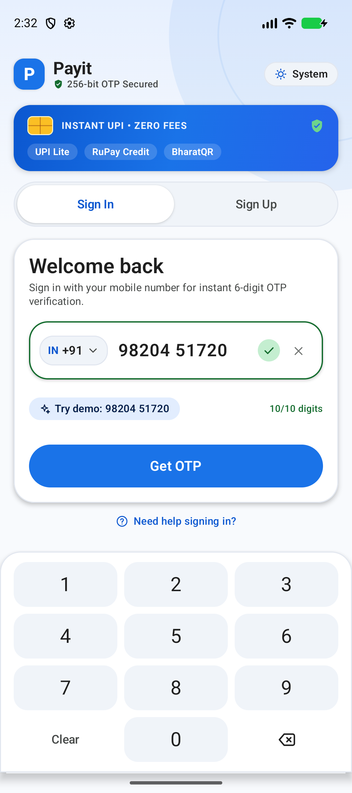 | 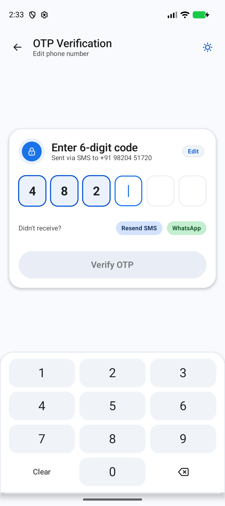 | 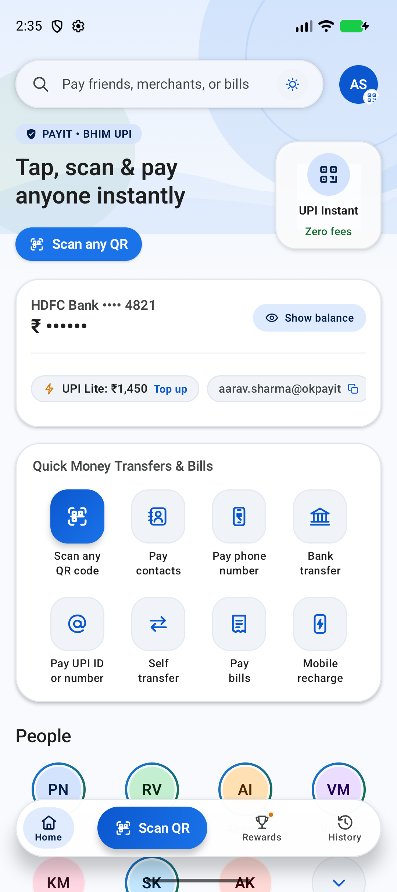 |
| Country dial-code selector, Sign In / Sign Up tabs, one-tap demo number fill & custom keypad | Interactive 6-digit OTP slots, 30-second SMS/WhatsApp resend timer & validation states | Quick-action grid, primary account peek card, UPI Lite balance, People & Businesses grids |

---

### 2. End-to-End Payment Flow & Mandatory UPI PIN Authorization

> Every payment path in Payit—Send Money, UPI Lite payments & top-ups, utility bills, mobile recharges, bank transfers, and self transfers—is gated behind **4-digit NPCI-style UPI PIN** verification before completing with the multi-layer `GPaySuccessTickHero` animation.

| QR Code Scanner | P2P Payment Chat Ledger | Send Money & Account Picker |
| :---: | :---: | :---: |
| 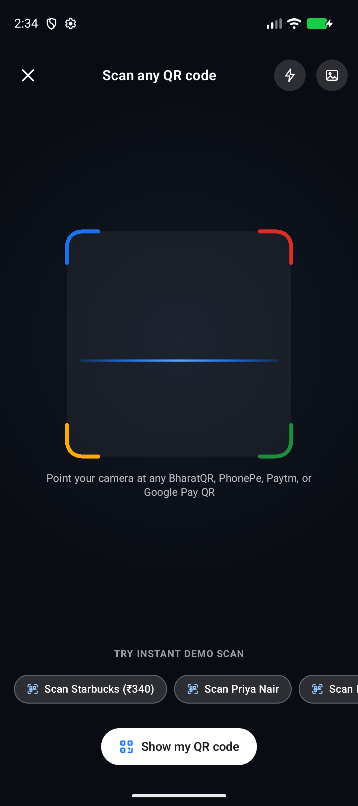 | 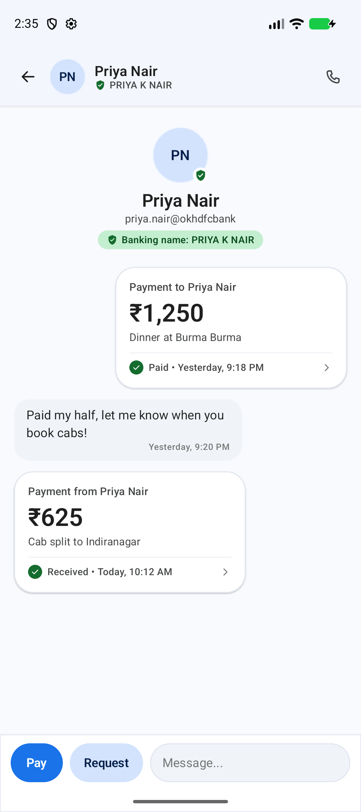 | 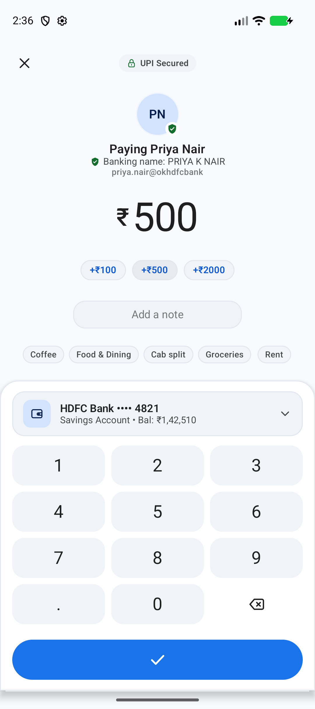 |
| Animated viewfinder laser, torch tint toggle, preset demo QR targets & Show My QR sheet | Conversational payment cards (sent/received), request flow & inline messaging | Quick amount chips, note tags, linked account switcher & custom numeric keypad |

| 4-Digit NPCI UPI PIN Gate | Animated Payment Success & Digital Receipt |
| :---: | :---: |
| 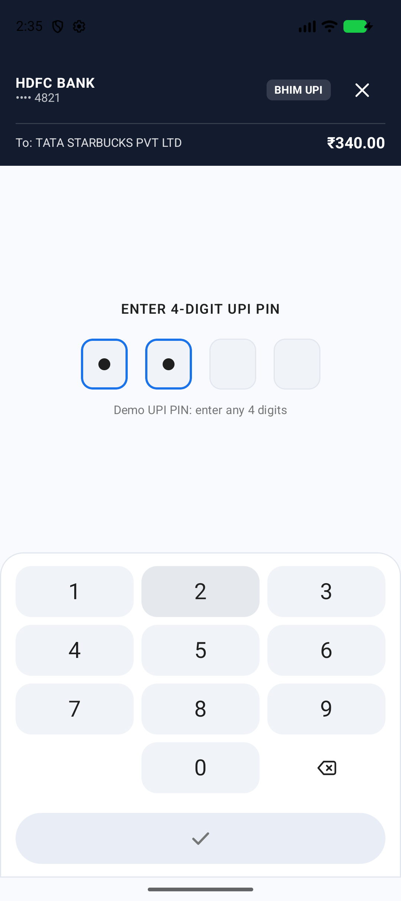 | 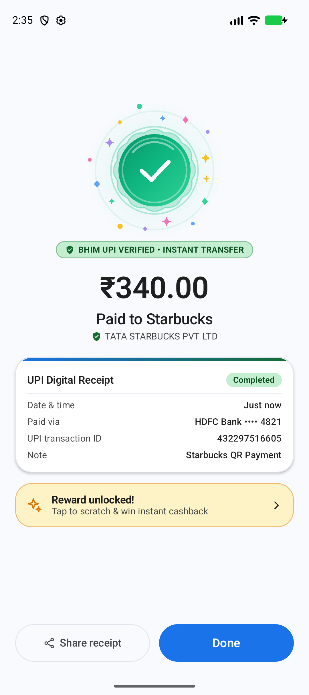 |
| Masked 4-digit PIN authentication displaying debiting bank (`HDFC BANK •••• 4821`), payee & exact payable amount | 5-layer `Canvas` tick hero (sonar ripples, rotating rosette seal, gradient medallion, drawn stroke & confetti burst) + itemized `UPI Digital Receipt` & unlocked reward callout |

---

### 3. Bills, Rewards, Transaction History & Credit Insights

| Bills & Recharges | Scratch Cards & Cashback | Transaction History | CIBIL Credit Insights |
| :---: | :---: | :---: | :---: |
| 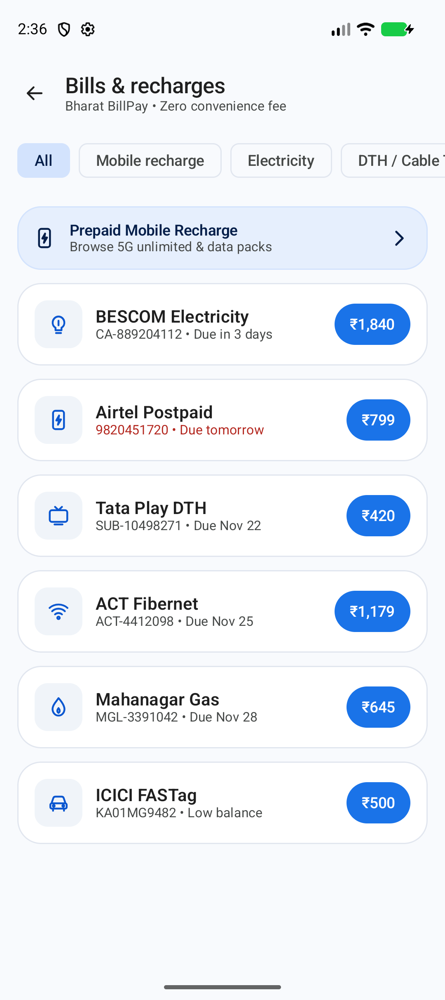 | 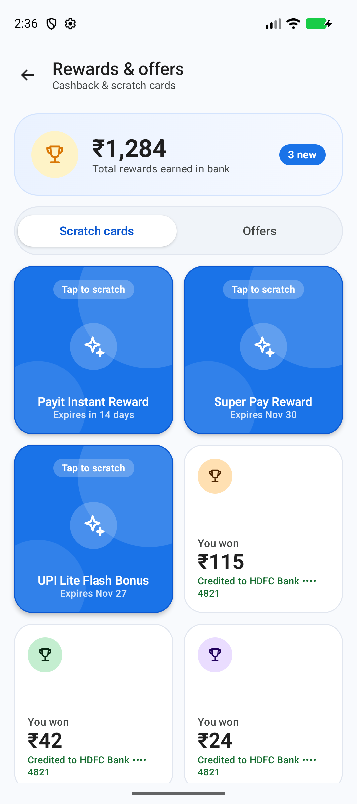 | 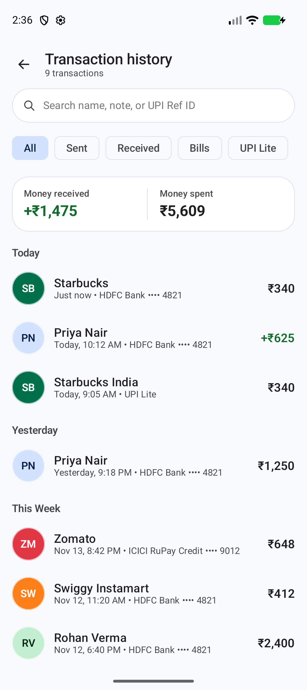 | 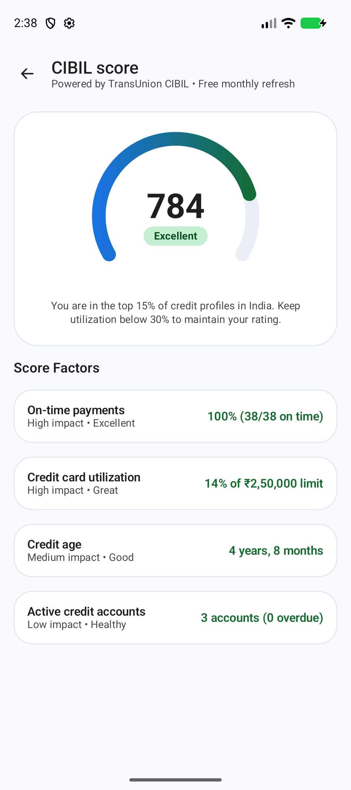 |
| Category filter pills, due badges & prepaid recharge routing | Pointer-drag scratch-off `Canvas` cards & live merchant offers | Instant search by name, note, or UPI Ref ID + filter chips | TransUnion CIBIL score arc (`784`) & weighted factor breakdown |

---

### 4. Adaptive Obsidian Dark Theme & Account Management

| Obsidian Dark Home | Linked Banks, RuPay UPI & UPI Lite | Personal QR & Appearance |
| :---: | :---: | :---: |
| 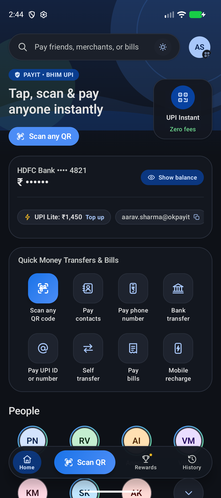 | 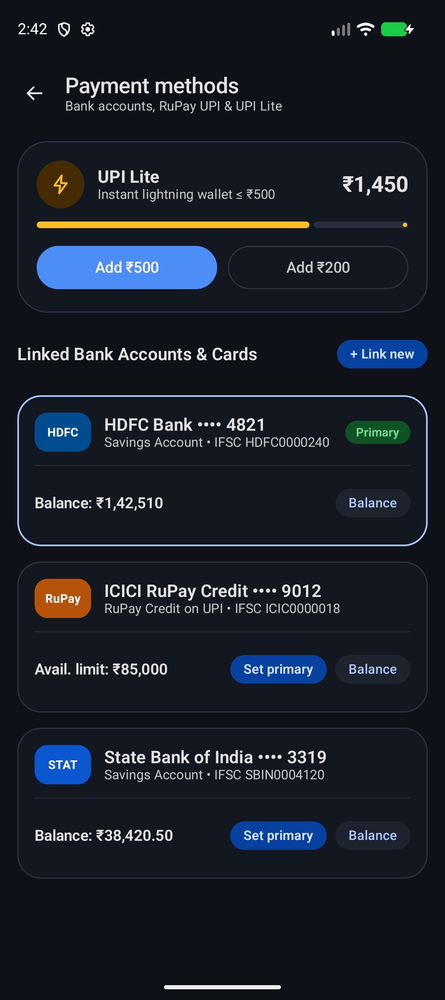 | 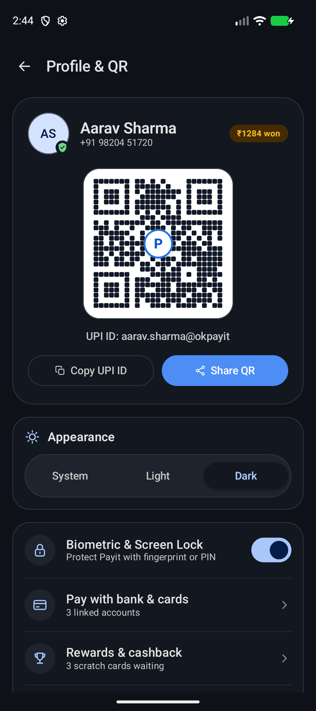 |
| Obsidian palette (`#0E1117` / `#1E232E` / `#A8C7FA`) adapting surfaces, cards & status bars | Primary account switching, UPI Lite top-ups (`₹2,000` cap) & account linking | Custom `GPayQrCodeView`, `System` / `Light` / `Dark` theme switch & biometric lock toggle |

---

## Navigation Architecture

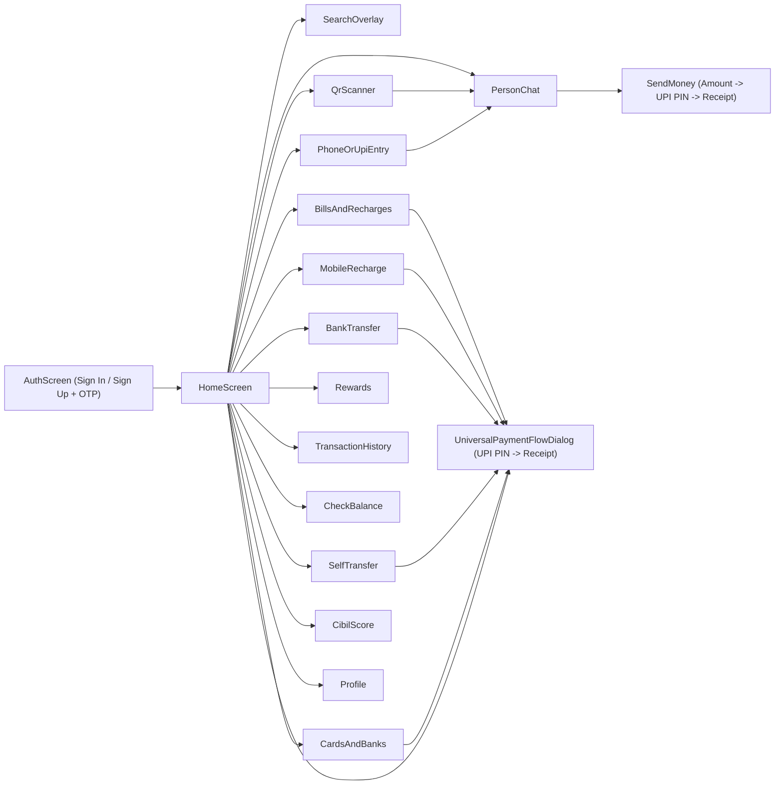

---

## Design System & Technical Stack

| Layer | Implementation Details |
| :--- | :--- |
| **Language & UI** | Kotlin `2.2.10`, Jetpack Compose (`BOM 2026.02.01`), Material Design 3 |
| **Theming (`PayitTheme`)** | `PayitExtendedColors` (19 semantic color roles) supporting `System`, `Light` (Alabaster `#F8FAFD` / Royal Blue `#0B57D0` / Emerald `#146C2E`), and `Dark` (Obsidian `#0E1117` / Sky Blue `#A8C7FA`), plus 16 curated `AvatarPalette` pairs |
| **Typography** | Custom Material 3 `Typography` scale enabling tabular numerals (`fontFeatureSettings = "tnum"`) across display, title, body, and label styles for aligned `₹` currency and PIN digits |
| **Iconography** | `49` custom `ImageVector` icons procedurally constructed in `PayitIcons`—zero external icon pack dependencies |
| **State & Persistence** | `PayitAppState` (`@Stable` Compose observable state holders) serialized to `SharedPreferences` (`payit_fullstack_prefs`, key `state_json`) via `org.json` |
| **System Integration** | Edge-to-edge rendering (`enableEdgeToEdge`) with dynamic light/dark system bar adaptation and `AnimatedContent` directional screen transitions across all `16` `PayitDestination` routes |

---

## Project Structure

```text
PayiTx/
├── README.md
├── screenshots/                         # Captured Pixel_9a screenshots used in documentation
└── app/src/main/java/com/example/payit/
    ├── MainActivity.kt                  # Edge-to-edge host, root Auth -> App navigation & SnackbarHost
    ├── model/
    │   └── PayitModels.kt               # 16 PayitDestination routes, data models, seed data & JSON persistence
    └── ui/
        ├── auth/
        │   └── AuthScreen.kt            # Phone Sign In / Sign Up, 6-digit OTP verification & resend timer
        ├── designsystem/
        │   ├── DesignSystem.kt          # Shared fintech components, numeric keypad, OTP boxes & QR view
        │   └── PayitIcons.kt            # 49 custom procedural ImageVector icons
        ├── screens/
        │   ├── HomeScreen.kt            # Dashboard, quick actions, people/business grids & quick-pay sheets
        │   ├── PersonChatScreen.kt      # Conversational payment threads, message composer & request sheet
        │   ├── QrScannerScreen.kt       # Simulated QR viewfinder, demo scan targets & My QR bottom sheet
        │   ├── SendMoneyScreen.kt       # Send Money stages, NpciPinPadStage, UniversalPaymentFlowDialog & GPaySuccessTickHero
        │   ├── RewardsScreen.kt         # Interactive Canvas scratch cards & merchant promo offers
        │   └── SecondaryScreens.kt      # History, Balance, Cards & Banks, Bills, Recharge, Transfers, CIBIL & Profile
        └── theme/
            ├── Color.kt                 # Light/Dark palettes, GPay brand accents & AvatarPalette
            ├── Theme.kt                 # PayitTheme, ThemeMode & LocalPayitColors provider
            └── Type.kt                  # M3 Typography scale with tabular numerals (tnum)
```

---

## Demo Data & Quick Testing Guide

| Flow | Seeded / Test Behavior |
| :--- | :--- |
| **Phone OTP Login** | Enter any valid mobile number for the selected country code; OTP is auto-generated and shown in an in-app SMS banner with **Auto-fill**. Enter `000000` to test invalid-OTP error handling. |
| **Default Demo Profile** | `Aarav Sharma` · `aarav.sharma@okpayit` · `+91 98204 51720` |
| **Linked Bank Accounts** | **HDFC Bank** (`•••• 4821`, Primary, `₹1,42,850.00`), **ICICI RuPay Credit** (`•••• 9012`, `₹85,000.00`), **State Bank of India** (`•••• 3319`, `₹38,420.50`) |
| **Default UPI PIN** | `1234` across seeded demo accounts |
| **UPI Lite Wallet** | `₹1,450.00` initial balance (`₹2,000.00` wallet cap); top-ups and payments authenticate with UPI PIN |
| **Sample Dataset** | `12` contacts, `8` merchants/utilities, `6` bills, `8` ledger transactions, `5` reward cards (`2` unscratched), `4` offers, `7` recharge plans, and `784` CIBIL score |
| **Resetting Data** | Open **Profile** → reset demo data to restore initial balances, transactions, and scratch cards |

---

## Build & Run

### Requirements
- **Android Studio** (compatible with AGP `9.5.1` and Gradle `9.6.0`)
- **JDK 11+** (`compileOptions` set to Java 11)
- **Android SDK Platform 37** (`compileSdk = 37`, `targetSdk = 37`, `minSdk = 24`)

### Steps
1. Clone the repository:
   ```bash
   git clone https://github.com/ramanujaganesh26/PayiTx.git
   cd PayiTx
   ```
2. Open the project in **Android Studio**, let Gradle sync dependencies, and run the `app` configuration on an emulator or Android device (`API 24+`).
3. Or build via the Gradle wrapper from the project root:
   ```bash
   ./gradlew assembleDebug
   ```
   *(On Windows PowerShell/CMD: `gradlew.bat assembleDebug`)*
