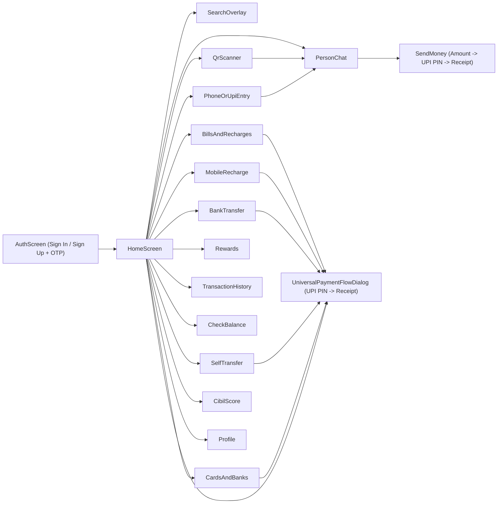

# Payit (`PayiTx`) — UPI & Digital Wallet Android App

A Google Pay–inspired UPI and digital wallet Android application built with **Kotlin**, **Jetpack Compose**, and **Material Design 3**. Designed with adaptive Light and Dark color systems, custom Canvas animations, procedural vector iconography, mandatory 4-digit UPI PIN authorization across every payment flow, and persistent local state via `SharedPreferences` + JSON.


---

## Overview

**Payit** models a complete mobile payments experience end to end—from phone-number authentication with 6-digit OTP verification to peer-to-peer chat ledgers, QR payments, utility bills, mobile recharges, bank/self transfers, scratch-card rewards, and credit health tracking.

All balances, linked accounts, contacts, chat threads, paid bills, scratched rewards, and transaction history persist locally on-device without requiring an external backend or third-party networking dependencies.

---

## Key Features

### Authentication & Onboarding
- **Sign In & Sign Up Modes**: Segmented auth flow with country dial-code selector, formatted mobile number input, optional email validation, and terms consent on sign-up.
- **6-Digit OTP Verification**: Custom numeric keypad (`GPayNumericKeypad`), 6-digit OTP slot row, simulated SMS delivery banner with one-tap auto-fill, 30-second resend countdown, and error handling.

### Universal UPI PIN Security & Success Experience
- **4-Digit NPCI-Style UPI PIN Gate**: Every payment execution path—Send Money, UPI Lite payments, UPI Lite top-ups, utility bill payments, mobile recharges, bank transfers, and self transfers—requires 4-digit UPI PIN confirmation (`NpciPinPadStage` / `UniversalPaymentFlowDialog`).
- **Animated Success Hero (`GPaySuccessTickHero`)**: Multi-layer Compose `Canvas` payment confirmation featuring radial sonar ripples, a rotating 12-lobe verification seal, emerald gradient medallion, progressive self-drawing checkmark stroke, confetti particle burst, and a `DigitalReceiptSummaryCard` with UPI reference ID and account metadata.

### Payments, Banking & Transfers
- **Home Dashboard (`HomeScreen`)**: Quick-action grid (Scan QR, Pay Contacts, Pay Phone Number, Bank Transfer, Pay UPI ID, Self Transfer, Bills & Recharges, Mobile Recharge), People & Businesses carousels, overdue bill banner, UPI Lite quick top-up sheet, and bottom navigation shortcuts.
- **P2P & Merchant Chat Threads (`PersonChatScreen`)**: Conversational payment history with bubbles for sent/received transfers, payment requests, and inline chat messages.
- **QR Scanner & Personal QR (`QrScannerScreen`)**: Animated laser viewfinder canvas with torch tint toggle, preset demo QR targets (merchant, contact, and utility bill), and a `Show My QR` sheet (`GPayQrCodeView`) with clipboard sharing.
- **Multi-Account Management (`CardsAndBanksScreen`)**: Switch primary account across seeded bank accounts and RuPay Credit on UPI, add new bank accounts, check balances (`CheckBalanceScreen`), or top up the on-device UPI Lite wallet (`₹2,000` cap).
- **Bank & Self Transfers (`BankTransferScreen`, `SelfTransferScreen`)**: Account/IFSC validation for external transfers and between-account self transfers with live balance updates.

### Bills, Recharges, Rewards & Insights
- **Utility Bills & Mobile Recharges**: Category filters across Electricity, Mobile Recharge, DTH/Cable TV, FASTag, Credit Card, Broadband, Piped Gas, and Water, plus categorized telecom recharge plans (`Popular`, `Data Add-on`, `Annual`).
- **Interactive Scratch Cards & Offers (`RewardsScreen`)**: Pointer-drag `Canvas` scratch-to-reveal cashback cards that credit earnings directly, paired with an Offers tab featuring one-tap promo code copy.
- **Transaction History & Search (`TransactionHistoryScreen`, `SearchOverlayScreen`)**: Categorized ledger with filter chips and unified search across people, businesses, and bills.
- **Credit Score & Profile (`CibilScoreScreen`, `ProfileScreen`)**: CIBIL score summary view (`784`), theme switcher (`System`, `Light`, `Dark`), biometric lock toggle, demo data reset, and sign-out.

---

## Navigation Architecture



---

## Design System & Technical Stack

| Layer | Implementation Details |
| :--- | :--- |
| **Language & UI** | Kotlin `2.2.10`, Jetpack Compose (`BOM 2026.02.01`), Material Design 3 |
| **Theming (`PayitTheme`)** | `PayitExtendedColors` (19 semantic color roles) supporting `System`, `Light` (Alabaster `#F8FAFD` / Royal Blue `#0B57D0` / Emerald `#146C2E`), and `Dark` (Obsidian `#0E1117` / Sky Blue `#A8C7FA`), plus 16 curated `AvatarPalette` pairs |
| **Typography** | Custom Material 3 `Typography` scale enabling tabular numerals (`fontFeatureSettings = "tnum"`) across display, title, body, and label styles for aligned `₹` currency and PIN digits |
| **Iconography** | `49` custom `ImageVector` icons procedurally constructed in `PayitIcons`—zero external icon pack dependencies |
| **State & Persistence** | `PayitAppState` (`@Stable` Compose observable state holders) serialized to `SharedPreferences` (`payit_fullstack_prefs`, key `state_json`) via `org.json` |
| **System Integration** | Edge-to-edge rendering (`enableEdgeToEdge`) with dynamic light/dark system bar adaptation and `AnimatedContent` directional screen transitions across all `16` `PayitDestination` routes |

---

## Project Structure

```text
app/src/main/java/com/example/payit/
├── MainActivity.kt                      # Edge-to-edge host, root Auth -> App navigation & SnackbarHost
├── model/
│   └── PayitModels.kt                   # 16 PayitDestination routes, data models, seed data & JSON persistence
└── ui/
    ├── auth/
    │   └── AuthScreen.kt                # Phone Sign In / Sign Up, 6-digit OTP verification & resend timer
    ├── designsystem/
    │   ├── DesignSystem.kt              # Shared fintech components, numeric keypad, OTP boxes & QR view
    │   └── PayitIcons.kt                # 49 custom procedural ImageVector icons
    ├── screens/
    │   ├── HomeScreen.kt                # Dashboard, quick actions, people/business grids & quick-pay sheets
    │   ├── PersonChatScreen.kt          # Conversational payment threads, message composer & request sheet
    │   ├── QrScannerScreen.kt           # Simulated QR viewfinder, demo scan targets & My QR bottom sheet
    │   ├── SendMoneyScreen.kt           # Send Money stages, NpciPinPadStage, UniversalPaymentFlowDialog & GPaySuccessTickHero
    │   ├── RewardsScreen.kt             # Interactive Canvas scratch cards & merchant promo offers
    │   └── SecondaryScreens.kt          # History, Balance, Cards & Banks, Bills, Recharge, Transfers, CIBIL & Profile
    └── theme/
        ├── Color.kt                     # Light/Dark palettes, GPay brand accents & AvatarPalette
        ├── Theme.kt                     # PayitTheme, ThemeMode & LocalPayitColors provider
        └── Type.kt                      # M3 Typography scale with tabular numerals (tnum)
```

---

## Demo Data & Quick Testing Guide

| Flow | Seeded / Test Behavior |
| :--- | :--- |
| **Phone OTP Login** | Enter any valid mobile number for the selected country code; OTP is auto-generated and shown in an in-app SMS banner with **Auto-fill**. Enter `000000` to test invalid-OTP error handling. |
| **Default Demo Profile** | `Aarav Sharma` · `aarav.sharma@okpayit` · `+91 98204 51720` |
| **Linked Bank Accounts** | **HDFC Bank** (`•••• 4821`, Primary, `₹1,42,850.00`), **ICICI RuPay Credit** (`•••• 9012`, `₹85,000.00`), **State Bank of India** (`•••• 3319`, `₹38,420.50`) |
| **Default UPI PIN** | `1234` across seeded demo accounts |
| **UPI Lite Wallet** | `₹1,450.00` initial balance (`₹2,000.00` wallet cap); top-ups and payments authenticate with UPI PIN |
| **Sample Dataset** | `12` contacts, `8` merchants/utilities, `6` bills, `8` ledger transactions, `5` reward cards (`2` unscratched), `4` offers, `7` recharge plans, and `784` CIBIL score |
| **Resetting Data** | Open **Profile** → reset demo data to restore initial balances, transactions, and scratch cards |

---

## Build & Run

### Requirements
- **Android Studio** (compatible with AGP `9.5.1` and Gradle `9.6.0`)
- **JDK 11+** (`compileOptions` set to Java 11)
- **Android SDK Platform 37** (`compileSdk = 37`, `targetSdk = 37`, `minSdk = 24`)

### Steps
1. Clone the repository:
   ```bash
   git clone https://github.com/ramanujaganesh26/PayiTx.git
   cd PayiTx
   ```
2. Open the project in **Android Studio**, let Gradle sync dependencies, and run the `app` configuration on an emulator or Android device (`API 24+`).
3. Or build via the Gradle wrapper from the project root:
   ```bash
   ./gradlew assembleDebug
   ```
   *(On Windows PowerShell/CMD: `gradlew.bat assembleDebug`)*
